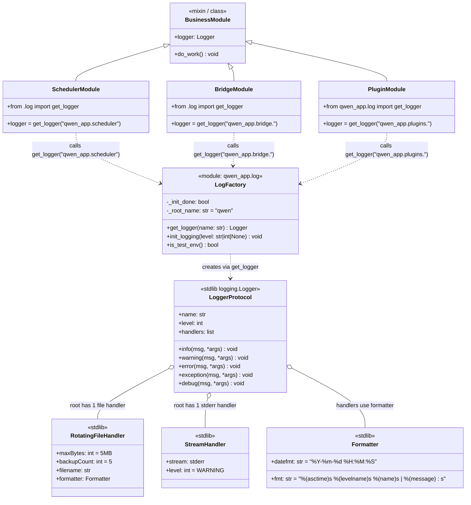
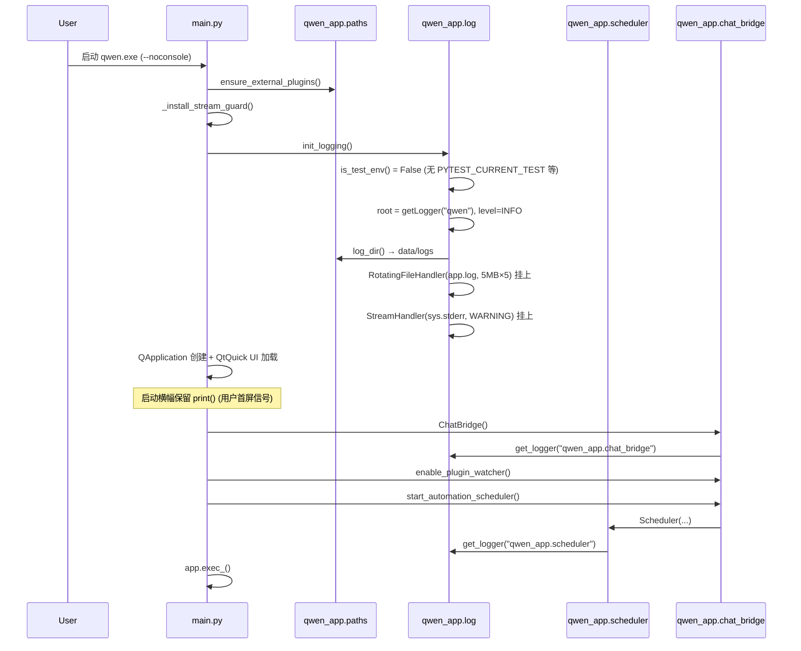
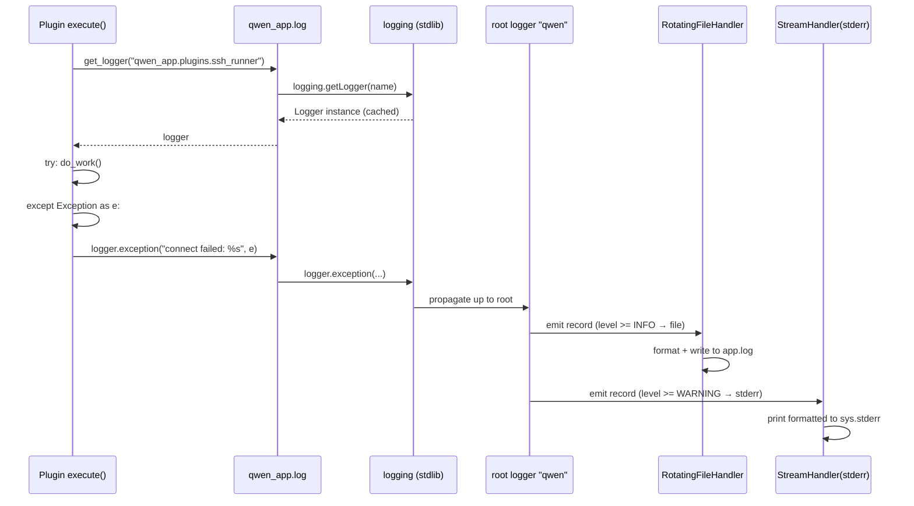
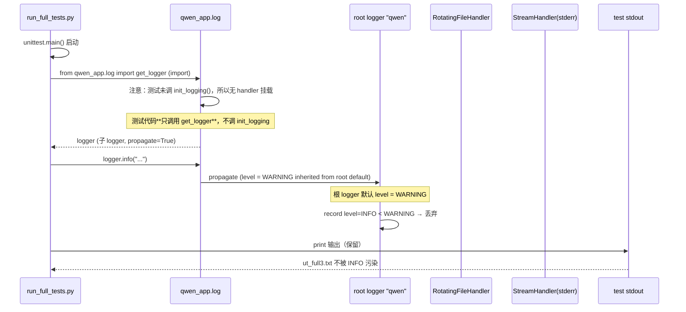
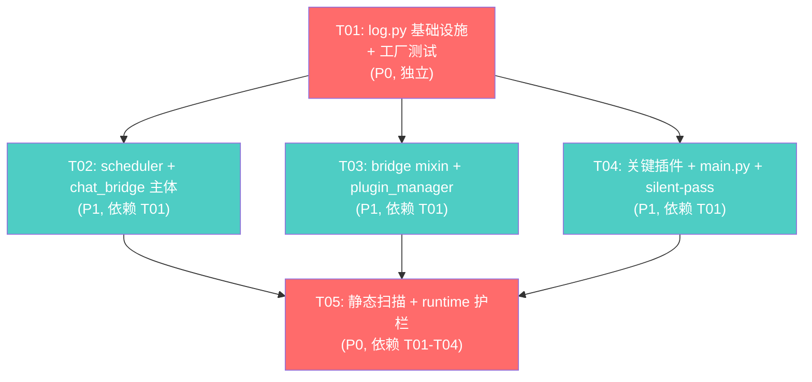

# qwen Logging 重构 — 系统设计（Day 20.10.10 P1+P2）

> 角色：Bob（架构师）｜交付对象：齐齐（工程师）+ 齐齐林（主理人）
> 范围：logging 架构落地 + 批次划分 + 任务列表
> 主参考：`tests/docs/refactor_logging_arch.md`（架构师完整设计稿）

---

## Part A · System Design

### 1. Implementation Approach

**核心挑战**：
- 146 处 `print()` 散布在 12+ 个文件 → 统一为 logger 但不破坏 `data/logs/app.log` 既有路径
- 493 处 `except Exception` 吞错 → 必须分档（silent-OK / silent-WARN / must-log-ERROR）
- 测试环境（offscreen）下不能让 INFO 日志污染 ut_full3.txt
- 打包态 `--noconsole` 下 stderr=None，logger 不能崩

**技术选型**：

| 维度 | 选型 | 理由 |
|------|------|------|
| 日志库 | stdlib `logging` | 不引入三方依赖；项目本就只用 PyQt5 + openai |
| 文件轮转 | `logging.handlers.RotatingFileHandler` | 5MB × 5 = ~25MB 上限，符合便携场景 |
| 命名 | 显式字符串 `qwen_app.<module>` | 源码态/PyInstaller 态都稳定 |
| 级别路由 | 根 logger + 子 logger propagate=True | 子 logger 不重复 setup |
| 测试降级 | 三重检测 `PYTEST_CURRENT_TEST` / `QT_QPA_PLATFORM=offscreen` / `QWEN_TESTING` | 现有测试 100% 走 offscreen |

**架构模式**：工厂模式（`get_logger(name)`）+ 单例模式（`init_logging()` 幂等）+ 分层（root + 子 logger + handlers）。

### 2. File List

```
新增：
  qwen_app/log.py                                    # 日志工厂 + 路由 + 测试降级
  tests/test_day20_10_10_log.py                      # 护栏：get_logger / 路由 / 幂等
  tests/test_day20_10_10_no_bare_print.py            # 护栏：静态扫描 print
  tests/test_day20_10_10_critical_paths_log.py       # 护栏：runtime 行为
  tests/docs/refactor_logging_arch.md                # 架构师交付（已写）

修改（业务模块）：
  main.py                                            # 启动横幅保留 + 其余 logger 化 + init_logging 钩入
  qwen_app/scheduler.py                              # 4 处 print + 5 处 except
  qwen_app/chat_bridge.py                            # 1 处 print
  qwen_app/_bridge_bubble.py                         # 12 处 print
  qwen_app/_bridge_send.py                           # 5 处 print
  qwen_app/_bridge_model.py                          # 10 处 print
  qwen_app/_bridge_plugin.py                         # 3 处 print + silent-pass 注释
  qwen_app/_bridge_menu.py                           # 7 处 print
  qwen_app/_bridge_stream.py                         # 2 处 print
  qwen_app/plugin_manager.py                         # 3 处 print + 1 处 traceback
  plugins/_secret_store.py                           # 1 处 print
  plugins/sql_helper.py                              # 3 处 print
  plugins/ssh_runner.py                              # 4 处 print
  plugins/web_search.py                              # 4 处 print
  qwen_app/scheduler.py                              # silent-pass 注释 ~2 处
  qwen_app/paths.py                                  # silent-pass 注释 ~4 处
```

### 3. Data Structures and Interfaces



**关键接口签名**（在 `qwen_app/log.py` 中）：

```python
def get_logger(name: str) -> logging.Logger:
    """模块级 logger 工厂。
    同名复用 Python 标准 cache；handler 配置在根 logger 上自动生效。
    """
    return logging.getLogger(name)

def init_logging(level: str | int | None = None) -> None:
    """幂等初始化：handler 已挂则跳过。
    测试环境下自动把根 logger level 提升到 WARNING。
    失败（写文件/挂 handler）一律降级不抛。
    """
    root = logging.getLogger("qwen")
    if getattr(root, "_qwen_init_done", False):
        return
    # ...挂 file handler + stderr handler + 设 level

def is_test_env() -> bool:
    """三重检测：PYTEST_CURRENT_TEST / QT_QPA_PLATFORM=offscreen / QWEN_TESTING"""
    ...
```

### 4. Program Call Flow

**场景 A：main.py 启动（打包态）**



**场景 B：业务模块 logger 调用**



**场景 C：测试环境降级**



### 5. Anything UNCLEAR

| # | 不确定点 | 默认假设 |
|---|----------|----------|
| 1 | `app.log` 与 `_install_stream_guard` tee 共写同一文件，是否有 lock 风险 | **假设安全**（同进程 line-buffered + 无并发写线程）；如观察 OSError 回退到 tee → `app_stdout.log` 分文件 |
| 2 | 测试 `run_full_tests.py` 是否要调 `init_logging()` | **不调**。让测试只走 `get_logger()`，根 logger 默认 WARNING 即可降级；如需 INFO 加 `QWEN_LOG_LEVEL=INFO` |
| 3 | 业务模块哪些 print 升级 ERROR/WARNING/INFO 的映射准则 | 架构师已在 `refactor_logging_arch.md §2` 给出 silent-OK/silent-WARN/must-log-ERROR 三档判定；工程师按表执行 |
| 4 | `chat_window.py` 与 `chat_qml_window.py` 的 print 是否本批处理 | **不处理**。它们非 P1+P2 范围；下一轮迭代 |
| 5 | plugins 内的 `print` 是否每个都迁移 | **关键插件迁移**（sql_helper/ssh_runner/_secret_store/web_search），其余插件实测 0 处 print，跳过 |

---

## Part B · Task Decomposition

### 6. Required Packages

```python
# 无新增依赖。stdlib logging.handlers.RotatingFileHandler + StreamHandler 已足。
# requirements.txt 不动。
```

### 7. Task List（按依赖顺序，≤5 任务）

| Task ID | Task Name | Source Files | Dependencies | Priority |
|---------|-----------|--------------|--------------|----------|
| **T01** | 项目基础设施（log.py + 工厂 API + 护栏测试） | `qwen_app/log.py`（新增）<br>`tests/test_day20_10_10_log.py`（新增）<br>`tests/docs/refactor_logging_arch.md`（已建，工程师读） | — | **P0** |
| **T02** | scheduler + chat_bridge 主体迁移（批 2 + 批 3 部分） | `qwen_app/scheduler.py`<br>`qwen_app/chat_bridge.py`<br>`qwen_app/_bridge_bubble.py`<br>`qwen_app/_bridge_send.py` | T01 | P1 |
| **T03** | 剩余 bridge mixin + plugin_manager 迁移（批 3 剩余 + 批 4 部分） | `qwen_app/_bridge_model.py`<br>`qwen_app/_bridge_plugin.py`<br>`qwen_app/_bridge_menu.py`<br>`qwen_app/_bridge_stream.py`<br>`qwen_app/plugin_manager.py` | T01 | P1 |
| **T04** | 关键插件迁移 + main.py 整合 + silent-pass 注释（批 4 + 批 5 + 批 6） | `plugins/_secret_store.py`<br>`plugins/sql_helper.py`<br>`plugins/ssh_runner.py`<br>`plugins/web_search.py`<br>`main.py`<br>`qwen_app/scheduler.py`（silent-pass 注释）<br>`qwen_app/paths.py`（silent-pass 注释）<br>`qwen_app/_bridge_plugin.py`（silent-pass 注释） | T01 | P1 |
| **T05** | 护栏测试（静态扫描 + runtime 行为） | `tests/test_day20_10_10_no_bare_print.py`（新增）<br>`tests/test_day20_10_10_critical_paths_log.py`（新增）<br>`tests/test_day20_10_10_log.py`（T01 已建，复用） | T01, T02, T03, T04 | **P0** |

**任务颗粒度约束满足**：
- 5 任务 ≤ 上限 5 ✓
- 每任务 ≥ 3 文件 ✓（T01=3, T02=4, T03=5, T04=8, T05=3）
- 第一个任务是项目基础设施 ✓
- 任务尽量独立或仅依赖 T01 ✓（T02/T03/T04 都只依赖 T01）

### 8. Shared Knowledge

- **命名规范**：`get_logger("qwen_app.<module>")` / `get_logger("qwen_app.bridge.<slice>")` / `get_logger("qwen_app.plugins.<name>")`
- **API 统一响应**：`{level, name, message, traceback?}`（stdlib logging 标准格式）
- **测试环境**：`PYTEST_CURRENT_TEST` / `QT_QPA_PLATFORM=offscreen` / `QWEN_TESTING=1` 三重检测
- **保留 `print()` 的场景**：
  - main.py 启动横幅（~3 处）
  - main.py `_run_selftest` 内 `emit()` 的 `print(s)`（selftest 模式专用）
  - 测试 fixture / 注释 / docstring 不属于本任务范围
- **silent-OK 注释模板**：
  ```python
  except Exception:
      # silent-OK: <具体理由 1 行>
      pass
  ```
- **不引入第三方**（如 loguru、structlog）；纯 stdlib `logging`

### 9. Task Dependency Graph



**关键观察**：
- T02/T03/T04 之间**业务独立**，可顺序也可**小并行**（但建议顺序，避免 PR 噪音）
- T05 是最后一道关卡，依赖前 4 批全部完成
- T01 是地基；T05 是质量门

---

## 验收门（DoD）

- [ ] T01 ~ T04 实现完成 + T05 护栏全过
- [ ] `python tests/run_full_tests.py` 仍 739 + 12 新增 = **751 测试全过**
- [ ] `data/logs/app.log` 同时有 logger 输出（带时间戳/level/name）和 tee 输出（raw print）
- [ ] 测试环境跑 `ut_full3.txt` 不被 INFO 日志污染
- [ ] 关键路径 493 处 `except Exception` 至少 80% 有 logger，剩余 ~20% silent-OK 带 1 行注释
- [ ] 业务代码 `print(` 数量从 146 降到 ≤ 5（main.py 启动横幅 + selftest 专用）

---

> **架构师 Bob 完稿。详细判定准则与 silent-OK 列表见 `tests/docs/refactor_logging_arch.md`。**
